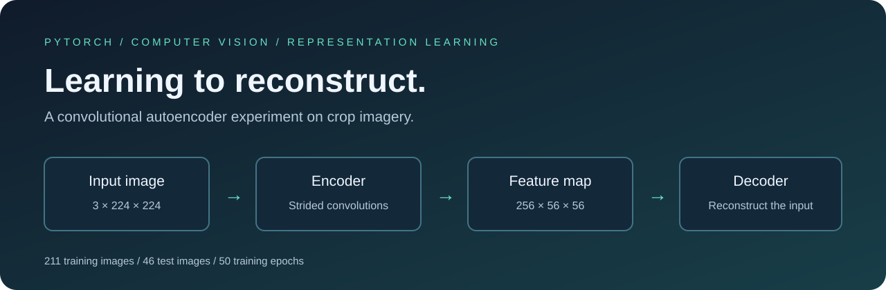
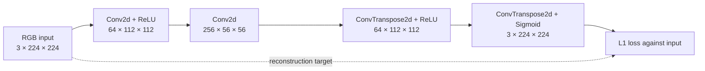
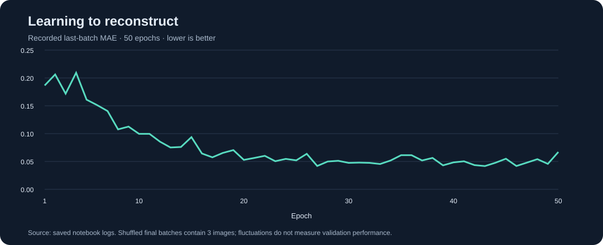
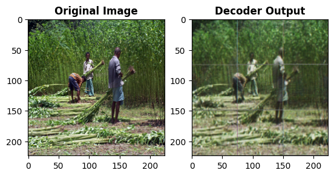
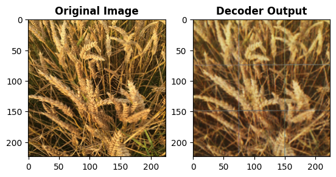
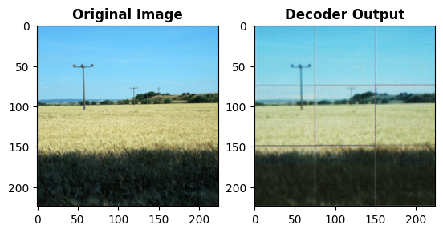

<p align="center">
  
</p>

# Convolutional Autoencoder

**Exploring how convolutional features can reconstruct agricultural images with PyTorch.**

An end-to-end learning experiment: prepare image tensors, build an encoder–decoder, optimize reconstruction loss, and inspect predictions on a separate image set. This repository presents the original notebook alongside its recorded results and a technical review of what those results establish.

[Explore the notebook](Convolutional%20Autoencoder.ipynb) · [Read the experiment analysis](docs/EXPERIMENT_ANALYSIS.md) · [Reproduce the workflow](docs/REPRODUCIBILITY.md)

> **Experiment snapshot** — 211 training images, 46 test images, 224 × 224 RGB inputs, 50 epochs. The saved run shows a decreasing training-loss trend and recognizable reconstructions, with visible blur and grid artifacts. Full test-set metrics were not recorded.

## The idea

An autoencoder learns to reproduce its own input. The encoder extracts a spatial feature representation; the decoder maps those features back to image space. No crop labels are used in the reconstruction objective.

This project explores representation learning on crop imagery rather than crop classification. It also illustrates an important distinction: reducing spatial resolution does not necessarily reduce the total number of stored features.

## Inside the network



| Component | Configuration |
| :--- | :--- |
| Encoder | Two 3 × 3 convolutions; stride 2, padding 1 |
| Decoder | Two 4 × 4 transposed convolutions; stride 2, padding 1 |
| Activations | ReLU after the first encoder/decoder layers; sigmoid at output |
| Objective | Mean absolute error (`nn.L1Loss`) |
| Optimizer | Adam, learning rate `0.0001` |
| Training | 50 epochs, batch size 16, shuffled batches |
| Trainable parameters | 415,427, calculated from the layer definitions |

**Representation size:** the encoder reduces width and height by 4× each, but increases channels from 3 to 256. Its output contains **802,816 values**, compared with **150,528 input values**—approximately **5.33× more elements**. This architecture is spatially downsampled, but it is not a compressed bottleneck by element count.

## Recorded results



| Recorded observation | Value |
| :--- | ---: |
| First epoch, last-batch MAE | 0.18654 |
| Lowest recorded last-batch MAE | 0.04176 (epoch 43) |
| Final epoch, last-batch MAE | 0.06701 |

These values come directly from saved notebook logs. Each point measures only the **last batch of an epoch**, which contains 3 images. Because batches are shuffled, the points reflect changing samples as well as model updates. They are neither epoch-average losses nor test scores; the final epoch is not the recorded minimum.

### From input to reconstruction

The following figures are exported directly from the notebook, without retouching. The left panel is the input visualization; the right panel is the decoder output.

| Example | What to inspect |
| :--- | :--- |
| Vegetation scene | Broad scene layout is recognizable; fine foliage and person details soften. |
| Grain close-up | Warm color and stem structure remain; fine texture becomes blurred. |
| Open field | Sky and field regions remain recognizable; grid artifacts are especially visible. |







**Interpretation matters.** The notebook uses `reshape` to convert HWC images to CHW tensors, and again to display the results. Reshaping does not reorder channel axes correctly. These figures therefore document the original experiment, but do not validate reconstruction quality under a correct RGB pipeline. See the [technical review](docs/EXPERIMENT_ANALYSIS.md) for the implications and correction.

## What this project demonstrates

- Building a custom convolutional encoder and decoder with PyTorch modules.
- Preparing an image dataset and training with minibatches, Adam, and L1 loss.
- Saving model parameters and running reconstruction inference.
- Examining visual quality alongside numerical training evidence.
- Reviewing tensor layout, representation size, and evaluation design critically.

## Run and explore

The notebook was run in Google Colab with a Google Drive dataset. The dataset and trained checkpoint are **not included** in this repository, and their source/license is not recorded in the notebook. To rerun training, supply an authorized dataset and update the notebook paths.

Start with the [reproduction guide](docs/REPRODUCIBILITY.md), which covers dependencies, expected folders, and fixes required for a corrected experiment. The original notebook is preserved with its saved outputs; the review does not imply a new training run.

To regenerate the documentation figures and loss data from the saved notebook, only Python 3 is needed:

```bash
python3 scripts/export_notebook_assets.py
```

## Next experiments

- Correct tensor axis ordering and retrain from scratch.
- Track sample-weighted epoch loss and a separate validation curve.
- Evaluate the entire test split with MAE, PSNR, and SSIM.
- Compare the current representation with a genuinely smaller bottleneck.
- Compare transposed convolutions with resize + convolution to investigate grid artifacts.

## Repository guide

| Path | Contents |
| :--- | :--- |
| [Convolutional Autoencoder.ipynb](Convolutional%20Autoencoder.ipynb) | Original implementation and recorded outputs |
| [docs/EXPERIMENT_ANALYSIS.md](docs/EXPERIMENT_ANALYSIS.md) | Findings, caveats, and prioritized improvements |
| [docs/REPRODUCIBILITY.md](docs/REPRODUCIBILITY.md) | Setup and corrected-workflow guidance |
| [assets/](assets/) | Original figures, presentation graphics, and extracted loss CSV |
| [scripts/export_notebook_assets.py](scripts/export_notebook_assets.py) | Standard-library exporter for recorded evidence |
